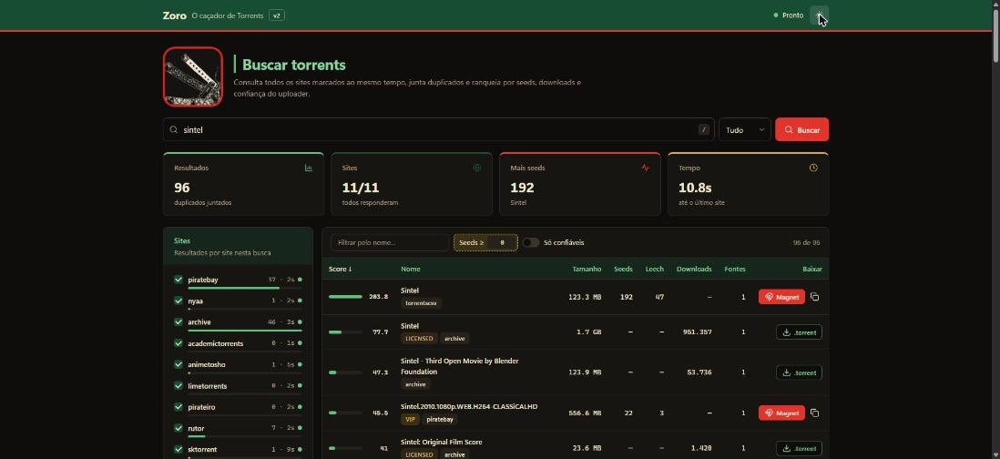
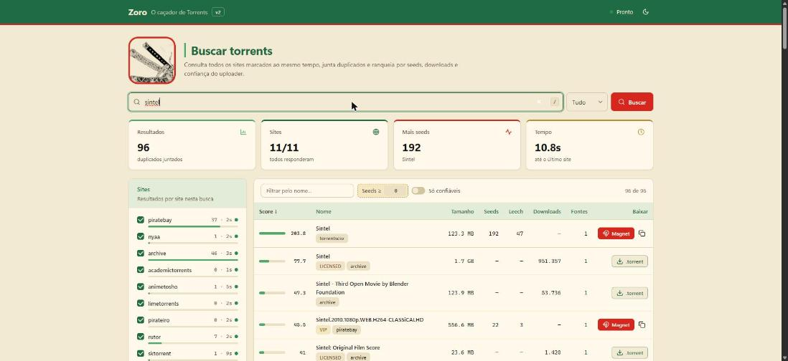

<p align="center">
  <picture>
    <source media="(prefers-color-scheme: dark)" srcset="assets/logo-dark.png">
    
  </picture>
</p>

<h1 align="center">Zoro — O caçador de Torrents</h1>

<p align="center">
  <b>Buscador de torrents grátis e de código aberto para o seu PC.</b><br>
  Busca em 11 sites de torrent ao mesmo tempo, junta duplicados e ranqueia por seeds, downloads e confiança do uploader.
</p>

<p align="center">
  <a href="../../releases/latest"><b>⬇️ Baixar para Windows</b></a> ·
  <a href="#-contribuir"><b>🤝 Contribuir</b></a> ·
  <a href="#-para-ias-e-agentes"><b>🤖 Para IAs</b></a>
</p>

<p align="center">
  
  
  
  
</p>

<p align="center">
  
  
</p>

---

**English:** Zoro is a free, open-source torrent search app (a torrent meta-search engine) for Windows, with a local browser UI and a CLI for LLM agents. It queries 11 indexers in parallel through [qBittorrent search plugins](https://github.com/qbittorrent/search-plugins), merges duplicates by infohash and ranks results by seeds, downloads and uploader trust. No account, no ads, no AI required, and it runs only on your machine. Contributions are welcome.

## ⚔️ Instalar (Windows)

1. Baixe **`Zoro-Setup.exe`** na [última release](../../releases/latest).
2. Rode o instalador. Não precisa de admin nem de Python.
3. Abra **Zoro** no menu Iniciar. O navegador abre em http://127.0.0.1:8765.

Para fechar, feche a janela do console. Para desinstalar: Configurações > Apps > Zoro.

> O exe não é assinado, então o SmartScreen ou o antivírus podem avisar. É um falso positivo comum em apps PyInstaller.

## 🗡️ O que ele faz

| | |
|---|---|
| **Todos os sites de uma vez** | Consulta os sites em paralelo; os resultados aparecem conforme cada um responde. Site fora do ar não trava a busca. |
| **Ranking honesto** | `(seeds + 0.25×leech + 10×log10(1+downloads)) × confiança` |
| **Confiança do uploader** | `VIP`/`trusted` do piratebay, `trusted`/`remake` do nyaa e `LICENSED` do archive.org, lidos direto das APIs. |
| **Sem duplicados** | O mesmo torrent (mesmo infohash) vindo de vários sites vira uma linha só (coluna "Fontes"). |
| **Um clique** | O Magnet abre no qBittorrent; links de página viram magnet na hora; archive.org baixa `.torrent`. |
| **Filtros** | Nome, seeds mínimos, só confiáveis, ordenação por qualquer coluna, atalho `/` para buscar. |
| **Tema claro e escuro** | Paleta verde-bandana, vermelho e bege. |

## 🛡️ Segurança

- Escuta só em `127.0.0.1`: nada fica exposto na rede.
- Bloqueia CSRF, DNS rebinding e SSRF (só resolve links que o próprio app retornou).
- CSP restrita e plugins de terceiros fixados por commit e sha256.

O pentest completo está em [SECURITY.md](SECURITY.md).

## 🏴‍☠️ Sites

| Site | Padrão | Tempo | Confiança | Downloads | Obs. |
|---|---|---|---|---|---|
| archive.org | ✅ | ~2s | licensed | ✅ | legal / domínio público, `.torrent` |
| piratebay | ✅ | ~3s | vip / trusted | — | magnet |
| nyaa | ✅ | ~7s | trusted / remake | ✅ | anime |
| limetorrents | ✅ | ~15s | — | — | link de página, vira magnet no clique |
| torrentscsv | ✅ | ~7s | — | — | magnet |
| rutor | ✅ | ~15s | — | — | russo, geral |
| pirateiro | extra | ~20s | — | — | geral |
| academictorrents | extra | 3–15s | — | — | datasets e cursos |
| yts | extra | 4–27s | — | — | filmes |
| animetosho | extra | ~20s+ | — | — | anime |
| sktorrent | extra | ~20s | — | — | eslovaco |

Foram testados os 73 plugins públicos da [wiki do qBittorrent](https://github.com/qbittorrent/search-plugins/wiki/Unofficial-search-plugins#plugins-for-public-sites). Só esses 11 funcionaram daqui; os outros estavam bloqueados, fora do ar ou desatualizados.

---

## 🤖 Para IAs e agentes

O Zoro tem uma CLI feita para LLMs, com saída em texto ou `--json`, e uma skill pronta para o Claude Code. Resumo para agentes em [llms.txt](llms.txt) e regras para quem programa com IA em [AGENTS.md](AGENTS.md).

```bash
python -I torrent_search.py "ubuntu 24.04" --json
```

## 🧭 Outros jeitos de usar

<details>
<summary><b>Rodar pelo código-fonte (qualquer SO com Python 3.10+)</b></summary>

```bash
git clone https://github.com/acert99/zoro-torrent-hunter ~/tools/zoro-torrent-hunter
cd ~/tools/zoro-torrent-hunter
pip install certifi
python -I setup.py     # baixa o runtime nova3 e os plugins fixados para vendor/
python -I web.py       # abre a interface (atalhos: start-ui.bat no Windows, ./start-ui.sh no Linux/macOS)
```
</details>

<details>
<summary><b>Linux e macOS</b></summary>

Pelo código-fonte, como acima, ou com `./start-ui.sh`. Para um pacote que roda sem Python instalado:

```bash
pip install pyinstaller certifi
python3 -I setup.py
python3 -I build.py    # dist/Zoro-linux-x86_64.tar.gz, dist/Zoro-macos-arm64.tar.gz...
tar xzf dist/Zoro-*.tar.gz && ./Zoro/Zoro
```

O workflow **build (Linux, macOS)** na aba Actions gera os dois pacotes. No macOS o app não é assinado: se o Gatekeeper bloquear, rode `xattr -dr com.apple.quarantine Zoro` na pasta extraída.
</details>

<details>
<summary><b>CLI para LLMs / Claude Code</b></summary>

```bash
python -I torrent_search.py "ubuntu 24.04" "debian 12" --top 5
python -I torrent_search.py "big buck bunny" --json
python -I torrent_search.py "sintel" --open 1     # abre o 1º resultado no qBittorrent
```

Skill do Claude Code:

```bash
mkdir -p ~/.claude/skills/torrent-search
cp skill/SKILL.md ~/.claude/skills/torrent-search/
```
</details>

<details>
<summary><b>Gerar o exe e o instalador</b></summary>

```bash
pip install pyinstaller certifi
python -I setup.py     # plugins em vendor/
python -I build.py     # dist/Zoro/Zoro.exe (Linux/macOS: dist/Zoro-<so>-<arq>.tar.gz)
ISCC installer.iss     # só Windows: Inno Setup 6 -> dist/Zoro-Setup.exe
```

Os plugins ficam congelados dentro do exe. Para atualizar os sites, gere de novo.
</details>

<details>
<summary><b>Por dentro</b></summary>

- Usa os [plugins de busca do qBittorrent](https://github.com/qbittorrent/search-plugins) (nova3), oficiais e não oficiais.
- piratebay, nyaa e archive.org são consultados direto pelas APIs, sem plugin.
- Cada site roda num processo próprio com timeout (`run_engine.py`); o `nova2.py` foi deixado de lado porque o multiprocessing dele é lento no Windows.
- Usa o bundle de certificados do certifi, porque stores velhos do Windows dão erro falso de `certificate has expired`.
</details>

## 🤝 Contribuir

O Zoro está aberto a contribuições, e dá para ajudar mesmo sem programar:

- **Código:** pegue uma issue [`good first issue`](../../issues?q=is%3Aissue+is%3Aopen+label%3A%22good+first+issue%22).
- **Sites:** teste plugins novos e avise quais pararam de funcionar.
- **Ideias e bugs:** abra uma [issue](../../issues/new/choose) ou puxe assunto nas [Discussions](../../discussions).
- **Divulgação:** deixe uma ⭐ para mais gente achar o projeto.

Como começar: [CONTRIBUTING.md](CONTRIBUTING.md).

## 📜 Licença e uso

- O código deste repositório é MIT. Os plugins baixados mantêm as próprias licenças (a maioria GPL).
- O Zoro só busca; ele não hospeda nada. Use para conteúdo legal: distros Linux, domínio público, archive.org, obras liberadas.
- Zoro e One Piece pertencem aos seus donos. Este é um projeto pessoal, sem fins comerciais.
